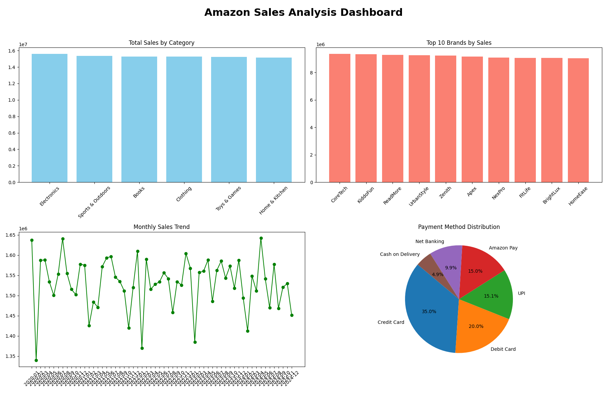
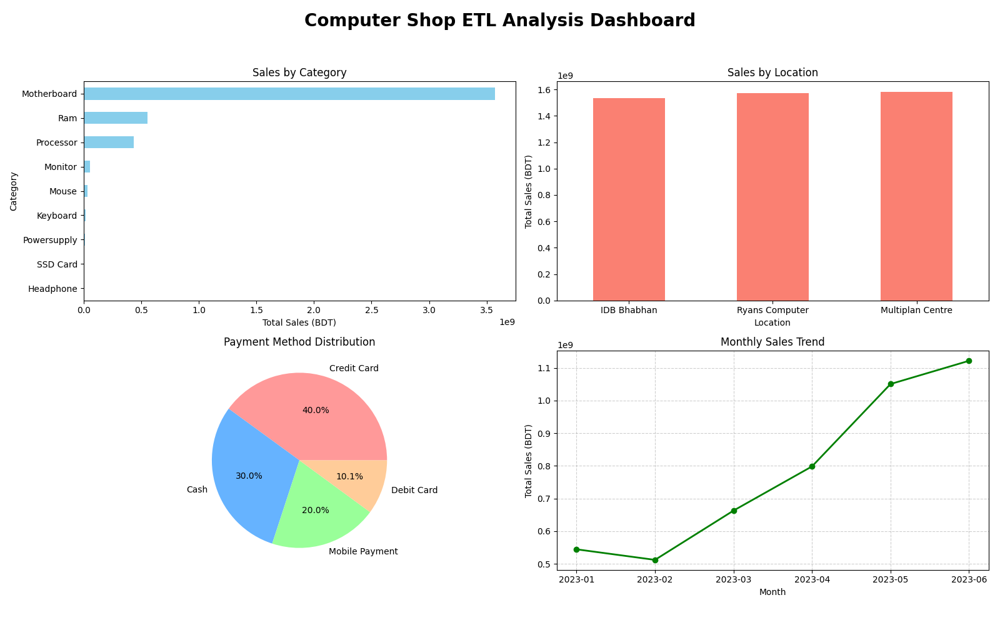

<div align="center">

# 🛒 Retail Intelligence Engine
### Multi-Source E-Commerce & Retail ETL Analytics Pipeline


<p align="center">
  <b>Transforming Raw Transactional Data into Actionable Business Intelligence</b>
  <br />
  <i>An end-to-end data engineering project developed during internship at DataSynthis</i>
</p>

---

</div>

## 📌 Executive Summary

The **Retail Intelligence Engine** is an enterprise-grade Extract, Transform, Load (ETL) pipeline engineered to convert raw transactional data streams into structured, analytics-ready datasets and business intelligence visual suites.

The framework integrates two distinct retail domains: **Global Amazon E-Commerce Sales** and **Local Hardware Retail Transactions**. Utilizing a layered **Raw → Silver → Gold (Medallion)** architecture, it automates ingestion, data cleansing, schema standardization, aggregation, and visual analytical rendering.

> [!NOTE]
> **Key Impact:** Establishes a reusable, zero-loss data engineering pipeline that enables executive decision-making across product category velocity, spatial revenue distribution, temporal sales patterns, and multi-channel payment preferences.

---

## 🏗️ Data Engineering Architecture
```
┌────────────────────────────────────────────────────────────┐
│ RAW DATA SOURCES │
│ │
│ Amazon E-Commerce Computer Retail Sales │
│ CSV CSV │
└──────────────────────────────┬─────────────────────────────┘
│
▼
┌────────────────────────────────────────────────────────────┐
│ INGESTION LAYER │
│ │
│ CSV Loading · Schema Inspection · Validation │
└──────────────────────────────┬─────────────────────────────┘
│
▼
┌────────────────────────────────────────────────────────────┐
│ SILVER LAYER │
│ │
│ Data Cleansing · Missing Values · Type Casting │
│ Deduplication · Standardization · Data Preparation │
│ │
│ silver_amazon_data.csv │
│ silver_computer_sales.csv │
└──────────────────────────────┬─────────────────────────────┘
│
▼
┌────────────────────────────────────────────────────────────┐
│ GOLD LAYER │
│ │
│ Category Sales · City Revenue · Brand Metrics │
│ Monthly Trends · Payment Summary · Location Sales │
│ │
│ Six Business-Ready Analytical Datasets │
└──────────────────────────────┬─────────────────────────────┘
│
▼
┌────────────────────────────────────────────────────────────┐
│ BUSINESS INTELLIGENCE │
│ │
│ Matplotlib · Seaborn · Executive Dashboards │
│ Performance Monitoring · Business Insights │
└────────────────────────────────────────────────────────────┘

text
```

### Layer Specifications

| Layer | Type | Responsibility | Key Outputs |
| :--- | :--- | :--- | :--- |
| **Raw** | Ingestion | Preserves unmodified source records from multi-channel streams | Source CSV files |
| **Silver** | Cleansing | Handles nulls, enforces schema typing, removes duplicates | `silver_amazon_data.csv`<br/>`silver_computer_sales.csv` |
| **Gold** | Aggregation | Builds dimensional metric cubes for executive BI consumption | 6 Curated Business Datasets |
| **Analytics** | Visualization | Renders high-resolution multi-panel executive dashboards | `amazon_etl_dashboard.png`<br/>`etl_full_analysis_dashboard.png` |

---

## 📊 Analytics & Dashboard Suite

### 01 — Amazon E-Commerce Intelligence
Visualizes global e-commerce activity across four critical business axes:
* 📦 **Category Revenue:** Evaluates demand across *Electronics, Sports & Outdoors, Books, Clothing, Toys & Games, and Home & Kitchen*.
* 🌍 **Geographic Performance:** Identifies top hub cities by revenue density (*Charlotte, Dallas, San Jose, Seattle*).
* 📈 **Monthly Sales Trends:** Tracks MoM seasonality patterns, velocity spikes, and temporal performance.
* 💳 **Payment Analytics:** Analyzes financial mix (*Credit Cards, Debit Cards, Net Banking, UPI, Amazon Pay, Cash on Delivery*).



---

### 02 — Computer Retail Intelligence
Explores localized hardware store throughput and branch-level performance:
* ⚙️ **Product Category Analysis:** Evaluates turnover across hardware components (*Motherboards, RAM, Processors, Storage*).
* 🏢 **Location Performance:** Benchmarks retail venue throughput (*IDB Bhaban, Ryans Computers, Multiplan Centre*).
* 💵 **Payment Vector Mix:** Analyzes customer adoption of mobile payments, cards, and cash.



---

## 📁 Repository Structure
amazon-sales-etl-pipeline/
│
├── 📄 README.md <- Project Architecture & Documentation
├── 🐍 real data.py <- Core ETL Logic, Data Pipeline & Dashboard Generator
├── 🐍 validate_data.py             # Automated Data Quality & Validation Module
├── 🐍 run_pipeline.py              # Pipeline Orchestration & Execution Script
├── 🐳 Dockerfile                   # Containerization Blueprint
├── 🐳 docker-compose.yml           # Multi-container Orchestration Config
├── 📋 requirements.txt             # Python Dependencies
│
├── 📂 Raw Datasets
│ ├── Amazon dataset csv.csv <- Source Global Amazon Sales Records
│ └── Computer parts Trancsaction.csv <- Source Hardware Store Transactions
│
├── 📂 Silver Layer (Cleansed)
│ ├── silver_amazon_data.csv <- Normalized Amazon Schema
│ └── silver_computer_sales.csv <- Normalized Hardware Store Schema
│
├── 📂 Gold Layer (Aggregations)
│ ├── gold_category_sales.csv <- Product Category Metrics
│ ├── gold_city_sales.csv <- Spatial City Revenue Distribution
│ ├── gold_brand_performance.csv <- Brand Performance Indices
│ ├── gold_monthly_trend.csv <- Time-Series Trend Aggregations
│ ├── gold_payment_summary.csv <- Payment Vector Metrics
│ └── gold_location_sales.csv <- Retail Branch Breakdown
│
└── 📂 Business Dashboards
├── amazon_etl_dashboard.png <- Executive Amazon BI Dashboard
└── etl_full_analysis_dashboard.png <- Hardware Retail Analytics Suite

text


---

## 🧰 Technology Stack

| Technology | Application |
| :--- | :--- |
| **Python 3.9+** | Core data engineering runtime and automation workflow |
| **Pandas** | Ingestion, data manipulation, missing value imputation, and Gold aggregation |
| **Matplotlib** | Multi-panel dashboard composition, subplot styling, and custom charting |
| **Seaborn** | Statistical visual aesthetics and distribution rendering |
| **CSV** | Structured intermediate storage for Silver and Gold layers |
| **Git / GitHub** | Source code management, documentation, and version control |

---

## 🚀 Quick Start Guide

### Prerequisites
* **Python 3.9** or higher installed on your machine
* **Git** version control system

### 1. Clone the Repository
```bash
git clone https://github.com/sajedulislam5840/amazon-sales-etl-pipeline.git
cd amazon-sales-etl-pipeline
2. Configure Virtual Environment
Windows:

Bash

python -m venv venv
venv\Scripts\activate
macOS / Linux:

Bash

python3 -m venv venv
source venv/bin/activate
3. Install Dependencies
Bash

pip install pandas matplotlib seaborn
4. Execute the ETL Pipeline
Bash

python "real data.py"
[!TIP]
Ensure both raw CSV files are placed in the root execution folder prior to running the script. Standardized datasets and dashboards will generate automatically upon script completion.
```
---

## 💡 Business Impact & Engineering Value

| Impact Pillar | Engineering Implementation | Strategic Business Value |
| :--- | :--- | :--- |
| **Architectural Rigor** | Multi-tier Medallion (Raw → Silver → Gold) pipeline | Enforces strict data lineage, source immutability, and 100% auditability |
| **Domain Harmonization** | Universal schema normalization engine | Blends multi-channel e-commerce logs and localized POS retail records into a unified relational core |
| **Automated Analytics** | Programmatic Seaborn & Matplotlib visualization suite | Eliminates manual spreadsheet reporting latency with dynamic, reproducible executive dashboards |
| **Commercial Intelligence** | Dimensional KPI aggregation matrices | Identifies high-velocity product categories, geographic revenue hubs, and payment gateway conversion dynamics |
| **Cloud Lakehouse Ready** | Decoupled, modular ETL pipeline logic | Simplifies future migration to enterprise cloud warehouses (*Snowflake, BigQuery, Databricks*) |

---

## 🔭 Technical Roadmap & Future Enhancements

> [!IMPORTANT]
> **Target Engineering Maturity:** Transitioning from local batch processing to an enterprise-grade, automated analytics lakehouse.

* 🔍 **Data Quality & Validation Framework**  
  Integrate `great_expectations` for automated schema enforcement, data contract validation, and automated ETL exception logging.

* ⚡ **Incremental Processing & Delta Loading**  
  Implement Change Data Capture (CDC) logic to process incoming transaction batches efficiently without full dataset re-scans.

* 🗄️ **Analytical Storage Engine**  
  Transition Silver and Gold layer persistence from flat CSV files to an embedded **DuckDB** / **PostgreSQL** OLAP data model for sub-second query performance.

* 📊 **Interactive Self-Service BI**  
  Deploy interactive visual analytics interfaces using **Streamlit** and **Power BI** for non-technical enterprise stakeholders.

* 🚀 **Containerization & Production Orchestration**  
  Containerize execution via **Docker** and automate DAG pipeline scheduling using **Apache Airflow**.

---

## 👨‍💻 Author Profile

<table align="center" width="100%">
  <tr>
    <td width="65%" valign="top">
      <h3>Sajedul Islam</h3>
      <p><b>Computer Science & Engineering Student</b> · <i>BRAC University</i><br/>
      <b>Former Data Preparation Specialist Intern</b> · <i>DataSynthis</i></p>
      <p>Specializing in Data Engineering, Analytics Infrastructure, and transforming complex transactional datasets into actionable enterprise intelligence.</p>
    </td>
    <td width="35%" valign="middle" align="center">
      <a href="https://sajedulislam5840.github.io/portfolio/">
        
      </a>
      <br/><br/>
      <a href="https://www.linkedin.com/in/sajedul-islam-data/">
        
      </a>
      <br/><br/>
      <a href="https://github.com/sajedulislam5840">
        
      </a>
    </td>
  </tr>
</table>

---

<div align="center">

**Retail Intelligence Engine**  
<sub>Engineered with Rigor · Structured for Insight · Built for Decisions</sub>

</div>
